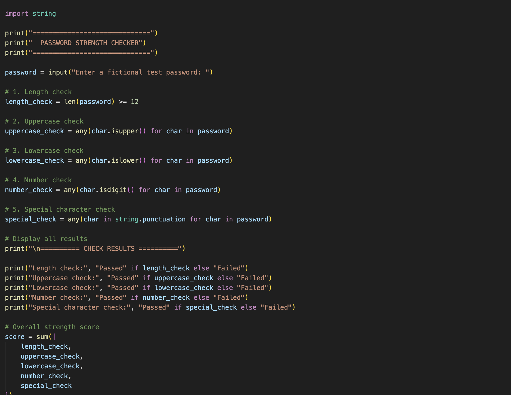
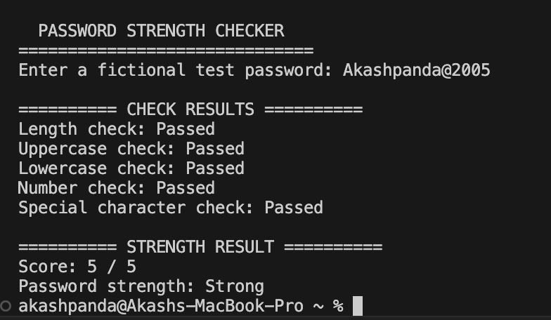

# Password Strength Checker

## Project Description
Password Strength Checker is a beginner-friendly cybersecurity project developed using Python. It checks password strength based on different validation criteria.

## Technologies Used
- Python 3
- Visual Studio Code

## Features
- Checks password length (minimum 12 characters)
- Detects uppercase letters
- Detects lowercase letters
- Checks for numbers
- Detects special characters
- Calculates an overall strength score out of 5
- Classifies password strength as Weak, Medium, or Strong

## Project Setup

### Requirements
- Python 3 installed
- Visual Studio Code or another Python editor

### How to Run

1. Clone this repository:

   `git clone https://github.com/akashpanda13march-wq/password-strength-checker.git`

2. Open the project folder.

3. Run the Python file:

   `python3 password_checker.py`

4. Enter a fictional test password when prompted.

## Example Output

```text
========== CHECK RESULTS ==========
Length check: Passed
Uppercase check: Passed
Lowercase check: Passed
Number check: Passed
Special character check: Passed

========== STRENGTH RESULT ==========
Score: 5 / 5
Password strength: Strong
```

## GitHub Repository
https://github.com/akashpanda13march-wq/password-strength-checker

## Disclaimer
This project is for educational purposes. It is a basic password-strength checker and does not guarantee password security.
## Screenshots

### Password Checker Code


### Password Checker Output

